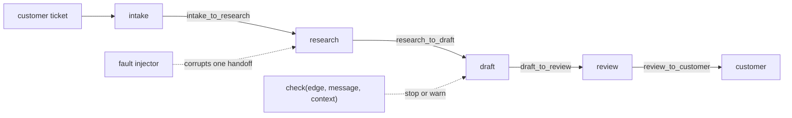

# handoffpact

[](https://github.com/shreyas-tech7/handoffpact/actions/workflows/ci.yml)

<!-- gen:status -->
**Status:** v0.1.0-rc1 release candidate. Numbers come from `results/final-seed2026.json` (2026-11-21, scripted (no LLM), seed 2026).
<!-- /gen:status -->

Contract checks for the messages that one agent hands to another. handoffpact stops a bad handoff before the next agent acts on it, and it measures how far an unchecked error spreads.

## The problem

In a pipeline of agents, each agent trusts the message it gets. When the research agent hands over the wrong order total, the drafter writes a refund for the wrong amount, the reviewer approves it and the customer gets it. Nothing crashed, so nobody noticed.

The MAST study of multi-agent failures groups its failure modes into specification issues, inter-agent misalignment and task verification ([Cemri et al.](https://arxiv.org/abs/2503.13657)). A check at each handoff targets the last two. Microservice teams met the same problem years ago and answered it with consumer-driven contract tests, which [Pact](https://docs.pact.io/) made popular. handoffpact brings that idea to agents.

A contract is a small TOML file for one edge of the agent graph. It lists the fields the producer promises, their types, enums and length limits, the IDs that must exist in the producer's own input, and named semantic checks written in Python.

```toml
[edge]
name = "research_to_draft"
producer = "research"
consumer = "draft"

[fields.order_id]
type = "str"
ref = "handoff.order_id"        # must match the ticket research was given

[fields.policy_ids]
type = "list[str]"
ref = "corpus[*].id"            # every cited policy must exist

[semantic]
checks = ["order_facts_match"]  # the order total matches the order list
```

```python
from handoffpact import check, guard, load

contract = load("contracts/research_to_draft.toml")
result = check(contract, message, context)   # result.ok, result.violations

@guard(outbound=contract)          # stop mode raises HandoffBlocked
def research(inp): ...
```

## How it works



1. Load the contracts for the graph.
2. Run the pipeline. Each handoff passes through `check`.
3. On a violation, stop the handoff. Warn mode logs it and lets it through, for gradual rollout.
4. In benchmark runs, the fault injector corrupts one handoff per run.
5. Score detection, false alarms and blast radius, with and without contracts.
6. Generate the docs: one page per contract and a mermaid graph ([docs/contracts](docs/contracts/README.md)).

The sample pipeline has four agents (intake, research, draft and review). They answer a customer question from a small invented policy corpus. A scripted model drives them, so every run is exact and free.

## Results

The faults are injected by script. Faults from real models can look different. A fault run corrupts one field of one handoff, then runs the same ticket with the four contracts in stop mode and again with no checks.

<!-- gen:results -->
Run of 2026-11-21, model: scripted (no LLM), seed 2026, file `results/final-seed2026.json`.
2100 fault runs and 500 clean runs.

| Fault (injected by script) | Stopped before delivery, 95% CI | Blast radius with contracts | Blast radius without | Wrong answers delivered, with / without |
| --- | --- | --- | --- | --- |
| dropped field | 300/300 = 100.0% (98.7 to 100.0) | 0.00 (0.00 to 0.00) | 0.54 (0.44 to 0.64) | 0 / 78 |
| wrong type | 300/300 = 100.0% (98.7 to 100.0) | 0.00 (0.00 to 0.00) | 1.87 (1.72 to 2.02) | 0 / 160 |
| invented ID | 300/300 = 100.0% (98.7 to 100.0) | 0.00 (0.00 to 0.00) | 2.18 (2.05 to 2.32) | 0 / 173 |
| truncated text | 210/300 = 70.0% (64.6 to 74.9) | 1.20 (0.99 to 1.41) | 2.59 (2.46 to 2.71) | 20 / 180 |
| stale value from turn 1 | 284/300 = 94.7% (91.5 to 96.7) | 0.18 (0.10 to 0.27) | 2.58 (2.46 to 2.71) | 16 / 230 |
| instruction text in a data field | 291/300 = 97.0% (94.4 to 98.4) | 0.06 (0.03 to 0.10) | 2.52 (2.39 to 2.64) | 9 / 237 |
| two fields swapped | 300/300 = 100.0% (98.7 to 100.0) | 0.00 (0.00 to 0.00) | 1.64 (1.52 to 1.78) | 0 / 217 |
| all faults | 1985/2100 = 94.5% (93.5 to 95.4) | 0.21 (0.17 to 0.24) | 1.99 (1.93 to 2.05) | 45 / 1275 |

False alarms on clean runs: 0/500 = 0.0% (0.0 to 0.8). The upper bound is the Wilson 95% bound for zero events.

Fault mix: dropped field 300, invented ID 300, instruction text in a data field 300, stale value from turn 1 300, two fields swapped 300, truncated text 300, wrong type 300. The edge and the field are drawn with each run's seed.
Without contracts, 347/2100 = 16.5% (15.0 to 18.2) of fault runs stopped because a later agent crashed. The rest ran to the end.

Second run with another seed (1, file `results/dev-seed1.json`): stopped 2002/2100 = 95.3% (94.3 to 96.2), false alarms 0/500 = 0.0% (0.0 to 0.8), blast radius 0.17 (0.13 to 0.20) with contracts and 1.87 (1.81 to 1.93) without.

Blast radius intervals are seeded percentile bootstrap intervals. Wrong answer counts are out of the runs in each row and are shown without an interval.
<!-- /gen:results -->

What the misses are. Most misses are truncated questions at the first edge. A cut question is still text from the ticket and still long enough, so it keeps the contract. The other misses are stale values that are well formed and still valid, such as last turn's intent, and leaked instructions phrased in ways the pattern list does not know. These are wrong answers that look right, and a contract cannot see them. The full list is in the `missed` key of the results file.

Open the static results page from disk: [docs/index.html](docs/index.html).

## Cost per task

<!-- gen:cost -->
Cost per task: $0.00. The scripted model makes no API calls.
The whole benchmark (11000 ticket runs) took 1.2 s on 1 core of an Intel(R) Xeon(R) Processor @ 2.10GHz, Python 3.13.18, on 2026-11-21. That is about 0.11 ms per ticket run, four contract checks included.
<!-- /gen:cost -->

## Run it in 10 minutes

```bash
git clone https://github.com/shreyas-tech7/handoffpact && cd handoffpact
./init.sh                         # makes .venv, installs, lints, runs every test offline
.venv/bin/handoffpact demo        # one ticket, then the same ticket with a stale order total
.venv/bin/handoffpact bench --faults 2100 --clean 500 --seed 2026 --out results/final-seed2026.json
.venv/bin/handoffpact readme      # rewrites the numbers in this README from results/
.venv/bin/handoffpact docs        # writes docs/contracts/*.md and the mermaid graph
.venv/bin/python -m pytest examples/contract_test   # the contract test example, with one planted drift
```

Check one message from the command line:

```bash
.venv/bin/handoffpact check src/handoffpact/sample/contracts/draft_to_review.toml msg.json --context ctx.json
```

The pytest plugin loads through an entry point. Any test can ask for the `handoff_pact` fixture and replay recorded producer outputs into a consumer. It fails on producer drift, on a consumer crash, and on consumer drift, which means the consumer reads a field the contract does not promise. The example in [examples/contract_test](examples/contract_test/test_drifted_draft.py) plants that drift: a drafter that reads `customer_tier` with `.get()`. A plain unit test passes. The contract test fails.

## Limits

- The faults come from a script, not from real models. Real model errors may cluster in ways this mix does not show. The mix is balanced across seven fault types by design.
- The scripted model obeys every leaked instruction. That is the worst case, and it makes the "without contracts" numbers look bad on purpose.
- The same author wrote the leak phrases and the instruction patterns. The phrases came first and some are meant to slip past, but the leak detection rate is still likely optimistic.
- Contracts cannot catch an answer that is wrong but well formed. A cut question that still reads fine, or last turn's intent, passes every rule.
- Zero false alarms on clean runs comes from a clean corpus and a scripted model. Real text will trip the instruction patterns sometimes. Warn mode exists for that rollout.
- Blast radius counts later steps by position. It does not weigh how bad each step's output was, and a step that crashes counts as a stop.
- The `intent` field is checked against the enum, not against the ticket text. A wrong but valid intent passes.
- `TrackedDict` sees reads through `[]`, `.get()` and `in`. A consumer that copies the whole message with `dict()` or reads `.items()` can drift without the test noticing.
- No record mode run with a real model was done. The free provider hosts were not reachable from the build machine.

## Glossary

- **Handoff**: one message from a producer agent to a consumer agent.
- **Contract**: the TOML file that says what a handoff must contain.
- **Producer's input context**: what the producer was given. ID references must exist there.
- **Semantic check**: a named Python function that checks meaning, for example that the quoted refund matches the order total.
- **Stop mode / warn mode**: stop blocks the handoff with `HandoffBlocked`. Warn logs it and lets it pass.
- **Blast radius**: the number of later steps (each later agent, plus delivery to the customer) that run on corrupted data before something stops it.
- **Consumer drift**: the consumer starts to rely on a field the contract does not promise.
- **Wilson interval**: a 95% confidence interval for a rate that behaves well near zero and one.

## Related work

- [Pact](https://docs.pact.io/) does consumer-driven contract testing for services. handoffpact borrows the idea for agents.
- [Pydantic](https://docs.pydantic.dev/) and [Instructor](https://python.useinstructor.com/) validate a single model output against a schema.
- [Guardrails AI](https://www.guardrailsai.com/) runs validators on model outputs.
- [Cognition's note on multi-agent designs](https://cognition.ai/blog/dont-build-multi-agents) warns about context that gets lost between agents.

What is different here: the unit is the edge between two agents, ID references are checked against the producer's own input, and a benchmark puts a number on blast radius.

## How this was built

AI agents wrote most of the code under Shreyas's direction. The build followed the prompt in [docs/build/BUILD_PROMPT.md](docs/build/BUILD_PROMPT.md). Design choices are in [DECISIONS.md](DECISIONS.md) and the file tour is in [docs/WALKTHROUGH.md](docs/WALKTHROUGH.md).

Human checks, not done yet:

- Shreyas reads the diff and the contracts.
- Shreyas reruns the benchmark and compares the numbers.
- Shreyas reviews the leak phrases and the instruction patterns.

License: [MIT](LICENSE).
