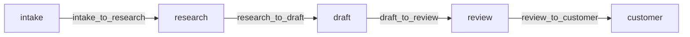

# Contracts

This page is generated by `handoffpact docs`. Each arrow is one handoff with its contract.

| Edge | Producer | Consumer | Fields | Semantic checks |
| --- | --- | --- | --- | --- |
| [intake_to_research](intake_to_research.md) | `intake` | `research` | 6 | 3 |
| [research_to_draft](research_to_draft.md) | `research` | `draft` | 8 | 4 |
| [draft_to_review](draft_to_review.md) | `draft` | `review` | 7 | 4 |
| [review_to_customer](review_to_customer.md) | `review` | `customer` | 5 | 3 |
